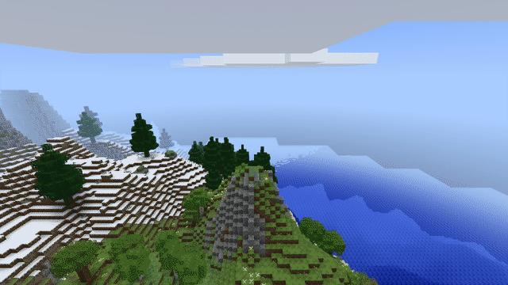
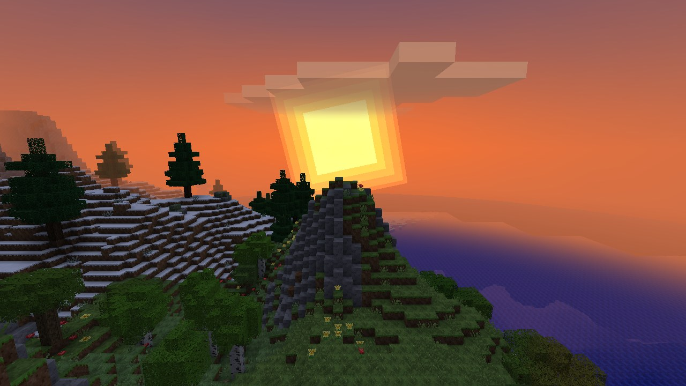
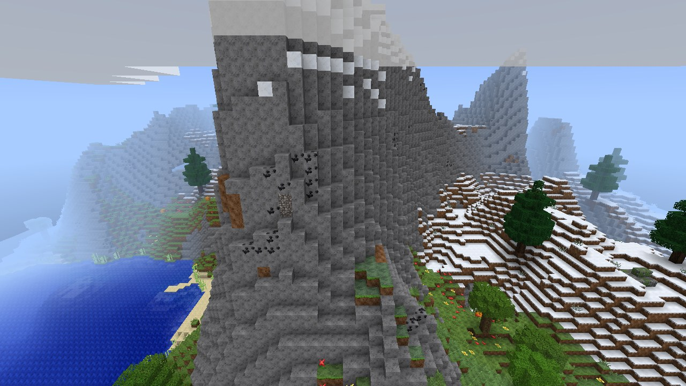
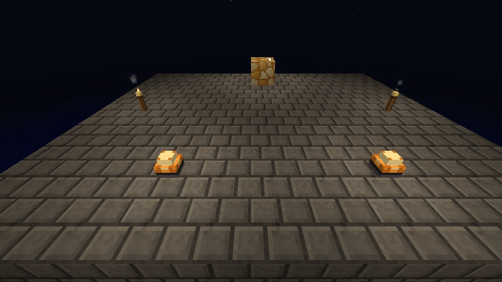
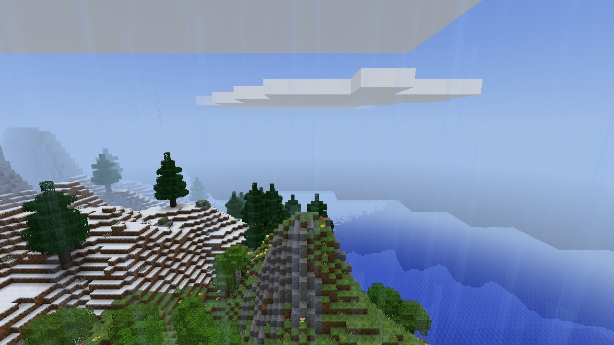
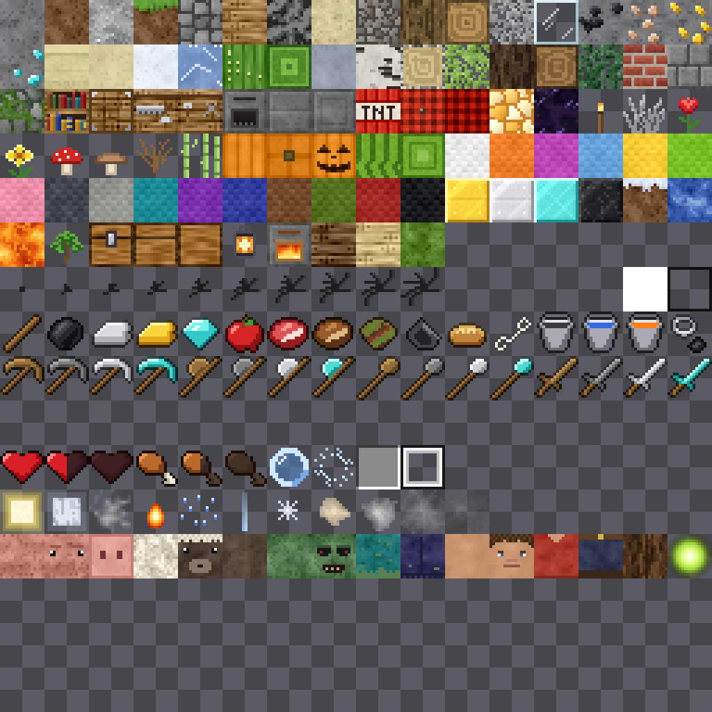

<div align="center">

# MineAssembly

### A Minecraft-like game written in x86-64 assembly

[](https://github.com/MosheByte/MineAssembly/actions/workflows/build.yml)


[](LICENSE)



**[⬇ Download MineAssembly.exe](https://github.com/MosheByte/MineAssembly/releases/latest)** · [How it works](docs/HOW_IT_WORKS.md) · [Multiplayer](docs/MULTIPLAYER.md) · [Architecture](docs/ARCHITECTURE.md) · [Contributing](CONTRIBUTING.md)

</div>

---

MineAssembly is a Minecraft-like game for Windows, written in x86-64 assembly. You can explore, mine, build and craft in it on your own, and it can host a world that real Minecraft Java Edition 26.1 clients can join.

The game ships no image, sound or music files. The textures, the font, the sound effects and the music all get generated by the code when the game starts. The exe only links against Windows itself: `kernel32`, `user32`, `gdi32`, `opengl32`, `winmm` and `ws2_32` (sockets, for multiplayer).

<table>
<tr>
<td></td>
<td></td>
</tr>
<tr>
<td></td>
<td></td>
</tr>
</table>

## What's in it

- Infinite procedural terrain with 12 biomes, rivers, overhangs, two kinds of caves, lava lakes, ores and per-biome trees. Chunks generate on a pool of worker threads.
- Flood-fill sky and block light with smooth lighting and ambient occlusion, a day/night cycle with sun, moon phases and stars, clouds, rain, snow and thunderstorms.
- Survival and creative. Health, hunger, drowning, fall damage, tool tiers, 62 crafting recipes, a furnace and chests.
- A few original mobs: Boar, Woolly, the Shambler (comes out at night, burns at sunrise) and Glowbugs.
- TNT with chain reactions, falling sand and gravel, flowing water and lava that mix into obsidian or cobblestone.
- Title screen, world list, settings, chat with 20+ commands (`/tp`, `/time`, `/give`, `/fill`, `/weather`...), F3 debug screen, third-person view.
- Saves only store the chunks you actually changed, RLE-compressed.
- A synthesizer for the sound effects and a generative ambient music system.
- Multiplayer with Minecraft Java Edition 26.1: friends join your world from the official launcher, and you see each other, chat and build together.

## Play

Grab `MineAssembly.exe` from the [latest release](https://github.com/MosheByte/MineAssembly/releases/latest) and run it. Nothing to install.

Windows will probably complain that the exe is unsigned ("More info → Run anyway"). If you'd rather not, building it yourself takes a few seconds (see below).

| Key | Action |
|---|---|
| `W A S D` | Move |
| Mouse | Look |
| `Space` | Jump · double-tap in creative to fly |
| `Shift` / `Ctrl` | Sneak / sprint |
| Left / right click | Break / place, use, attack |
| Middle click | Pick block (creative) |
| `1`-`9` / wheel | Select hotbar slot |
| `E` | Inventory |
| `Q` | Drop item |
| `T` or `/` | Chat and commands |
| `F1` `F2` `F3` `F5` `F11` | Hide HUD · screenshot · debug · camera · fullscreen |

## Play with Minecraft Java Edition

MineAssembly can open the world you're in to real Minecraft Java Edition clients. Load a world and type `/host` in chat, and Windows may ask whether to let MineAssembly through the firewall. Your friend creates an installation for version 26.1 in the official launcher, then goes to Multiplayer → Add Server and enters your IP address (plus `:port` if you didn't use 25565). It runs in offline mode, which means player names aren't verified, so only use it on your LAN or with people you trust. Setup, limits and troubleshooting are in [docs/MULTIPLAYER.md](docs/MULTIPLAYER.md).

```bat
/host                                          (in chat) open the world on port 25565
/host 25570                                    (in chat) same, on another port
MineAssembly.exe --world myworld --host 25565  load a world and open it straight away
```

## Building

You need [NASM](https://www.nasm.us/) 2.15+ and [MinGW-w64](https://www.mingw-w64.org/). I only use `gcc` as the linker driver, nothing gets compiled. The build tool is assembly too, so you build that first (repo root, `cmd.exe`):

```bat
nasm -f win64 -I include\ -I tools\ tools\mabuild.asm -o mabuild.obj
gcc -nostdlib -o mabuild.exe mabuild.obj -Wl,-e,start -Wl,--subsystem,console -lkernel32 -luser32
```

In PowerShell, quote the `-Wl,...` arguments and call it as `.\mabuild`. After that:

| Command | What it does |
|---|---|
| `mabuild` | builds `MineAssembly.exe` (modules assemble in parallel, takes about half a second) |
| `mabuild test` | builds and runs every unit test |
| `mabuild scenario tests\scenarios\example_build.txt` | plays a scripted scenario in a clean folder and saves the screenshots as PNG |

`mabuild --help` has the rest. To check that rendering works on your machine:

```bat
MineAssembly.exe --selftest
```

That generates a world, flies a fixed camera path, saves 5 screenshots and writes timing stats to `mineassembly.log`.

## How it works

The long version is [docs/HOW_IT_WORKS.md](docs/HOW_IT_WORKS.md). Short version: 45 source files, around 70,000 lines, every global function follows the Microsoft x64 calling convention through a couple of `PROC`/`ENDP` macros, and modules only talk to each other through one contract file, [`include/api.inc`](include/api.inc).

| Subsystem | File(s) | Lines |
|---|---|---|
| Procedural textures | `texgen.asm` | 5,494 |
| Terrain, biomes, caves, trees | `worldgen.asm` | 3,723 |
| Player controller and mining | `player.asm` | 3,043 |
| Renderer and chunk mesher | `render.asm`, `mesher.asm` | 4,659 |
| Sky, clouds, particles, weather | `sky.asm`, `particles.asm`, `weather.asm` | 6,021 |
| Sound effects and music | `audio.asm`, `music.asm` | 3,522 |
| Entities, mob AI, explosions | `entity.asm`, `mobs.asm`, `explosion.asm` | 5,188 |
| UI, HUD, menus, chat | `ui.asm`, `hud.asm`, `menus.asm`, `console.asm` | 7,815 |
| Java Edition multiplayer | `net.asm`, `mcproto.asm`, `mcplay.asm`, `mcmap.asm`, `mcdata.asm` | 9,274 |

<p align="center"><br><sub>The whole texture atlas. None of it is stored anywhere, it's drawn at startup.</sub></p>

## Contributing

Bug reports, review comments on the assembly, faster instruction sequences, new tests: all welcome. [CONTRIBUTING.md](CONTRIBUTING.md) explains the build, the tests and the rules, and the [roadmap](docs/ROADMAP.md) has bigger ideas.

## License

[MIT](LICENSE). MineAssembly is an original Minecraft-like game. It is **not affiliated with or endorsed by Mojang or Microsoft**, and it contains no code, art or sounds from Minecraft.
