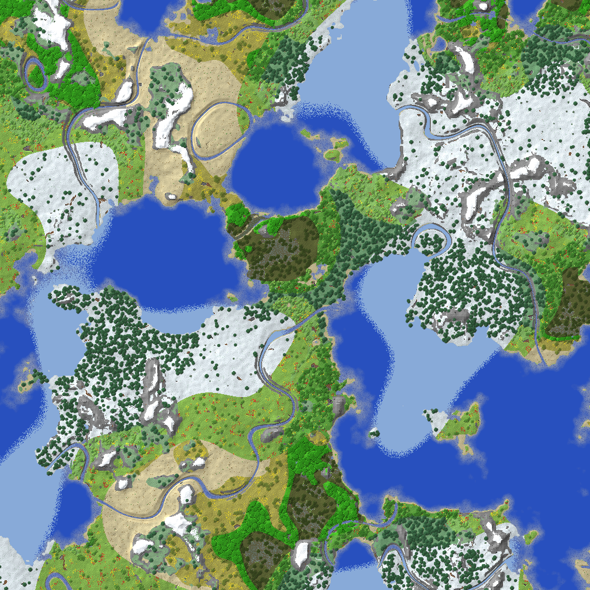

# How MineAssembly works

MineAssembly is a Minecraft-like game: infinite procedural worlds, survival and creative, crafting, mobs, TNT, flowing water and lava, day/night and weather. It can also host a world that real Minecraft Java Edition 26.1 clients join over the network. It's written directly in x86-64 assembly (NASM, no compiler, no C runtime) for Windows x64.

There are 45 source files in `src/`, about 70,000 lines. The exe is around 490 KB and only imports `kernel32`, `user32`, `gdi32`, `opengl32`, `winmm` and `ws2_32`. There are no asset files: every texture, the font, every sound and all the music get generated at startup. On Intel integrated graphics at render distance 8 (349 chunks, roughly 1.5 million vertices) the self-test runs at 100 to 170 FPS, and it takes 122 ms from process start to the title screen.

This doc goes through the engine one piece at a time. Code excerpts are copied from the source, with `...` where I left lines out. For the module layout and the cross-module rules, see [ARCHITECTURE.md](ARCHITECTURE.md).

---

## Frame loop and threads

```
                    main.asm: start -> main loop (variable dt)
                                   |
        platform_pump --------> game_frame(dt) ------------> platform_swap
        (Win32 messages,          |
         raw input)               |-- 20 Hz fixed ticks (accumulator, max 5/frame)
                                  |     player, entities, mobs, block ticks,
                                  |     fluids, furnaces, weather, music, autosave
                                  |-- player_update(dt)    movement, raycast, mining
                                  |-- chunkmgr_update      stream chunks, promote to LIT
                                  |-- render_update_meshes budgeted, nearest first
                                  |-- net_update, mcplay_tick  Java clients (only while hosting)
                                  '-- game_render          sky, world, entities, UI

   worker threads (1..8): worldgen_generate / save_load_chunk on queued chunks
   mixer thread:          waveOut buffers, SFX voices, generative music
```

The simulation runs at a fixed 20 ticks per second. Rendering goes as fast as the GPU allows and interpolates moving things with `g_partial_tick`, so motion looks smooth at any frame rate. The 45 files are split into 16 module groups, and they only talk to each other through what's declared in `include/api.inc` (plus `include/net.inc` for the multiplayer modules).

## Calling convention and frame macros

Without a compiler, the calling convention is something you follow by hand, so I made it as hard as possible to get wrong. Every global function uses the Microsoft x64 convention, including calls between my own modules:

```
int/ptr args : rcx, rdx, r8, r9, then the stack at [rsp+32] ...
float args   : xmm0..xmm3 (positional: arg N uses rcx/rdx/r8/r9 OR xmmN)
return       : rax / xmm0
volatile     : rax rcx rdx r8 r9 r10 r11 xmm0-xmm5
nonvolatile  : rbx rbp rsi rdi r12-r15 xmm6-xmm15
caller reserves 32 bytes of shadow space; rsp is 16-byte aligned at `call`
```

Most of it lives in two macros in `include/common.inc`. `PROC` saves every nonvolatile general-purpose register, reserves room for locals, and leaves 96 bytes at the bottom (32 bytes of shadow space plus 8 outgoing stack args). So inside a function the stack is always aligned and any `call` just works.

```nasm
%macro PROC 1-2 0
    global %1
    align 16
%1:
    push rbp
    mov  rbp, rsp
    push rbx
    ...
    push r15
    sub  rsp, (((%2)+15) & ~15) + FRAME_OUT + 8
%endmacro

%define LOC(n) [rsp+FRAME_OUT+(n)]
%define ARG5 [rbp+48]
```

`PROCX`/`ENDPX` also save `xmm6` through `xmm15` for float-heavy code. `ENDP` restores everything from `rbp`, so an early exit is just `jmp .done`. Pushing seven registers in every function costs a few cycles. I'll pay that to avoid a function that forgets to preserve `r13` and crashes something ten calls later in another module.

Hot leaf functions skip the frame (`world_get_block` is a `LEAF` that only touches volatile registers). Private helpers aren't `global`; each module has an `LPROC` twin of `PROC` for that, so two modules can't collide at link time.

Two other rules catch the classic mistakes. Everything is RIP-relative (`default rel`), so tables are indexed as `lea rax, [rel tbl]` then `[rax+rcx]`, never `[tbl+rcx]`, which would need an absolute 32-bit relocation. And floors of possibly negative values go through `math_floor` or `roundss` mode 1, because `cvttss2si` truncates toward zero and gets `x = -0.5` wrong.

Reading the code isn't enough to catch slips in any of this, so the tests also check the ABI by machine (see [How it's tested](#how-its-tested)).

## Entry point, window and input

With no CRT, the linker entry point (`-Wl,-e,start`) is the very first instruction the process runs. Windows enters it with `rsp = 8 (mod 16)`, as if it had been called, so the first job is fixing the alignment:

```nasm
start:
    and  rsp, -16
    sub  rsp, 32
    call main_entry
    mov  ecx, eax
    call ExitProcess
```

`main.asm` parses its own command line (`--selftest`, `--bench`, `--seed N`, `--world NAME`, `--script FILE`; a non-numeric seed gets hashed with FNV-1a) and then runs the loop: pump messages, get `dt` from `QueryPerformanceCounter`, call `game_frame`, swap. `dt` is clamped to 0.1 s so a breakpoint or a window drag doesn't produce one giant simulation step.

`platform.asm` is the whole OS layer. The client area is exactly 1280×720, with a 32-bit RGBA, 24-bit depth, double-buffered pixel format. Even the window icon is procedural: `build_icon` paints a little isometric grass block and hands it to `CreateIcon`. The GL 2.0 entry points aren't exported by `opengl32.dll`, so `gl.asm` loads them through `wglGetProcAddress` once a context exists.

Mouse look uses Raw Input (`WM_INPUT`), so you get unaccelerated device counts that don't care where the cursor is. Remote desktop and VMs send absolute raw coordinates instead, which get turned into deltas, and high-resolution wheels that send less than `WHEEL_DELTA` per message get accumulated. On the keyboard side, `g_keys_pressed[vk]` only fires on the up→down edge, but `game_on_key` still sees auto-repeat so text fields repeat properly. File writes are atomic (write `path.tmp`, then `MoveFileEx` with `REPLACE_EXISTING`), and the log is timestamped and thread-safe.

## Textures drawn by code

`texgen.asm` is the biggest file. At startup it paints a 256×256 RGBA atlas of 16×16 tiles out of a handful of primitives: an integer avalanche hash, 2D value noise in 8.8 fixed point whose lattice wraps at 16 (so every tile wraps cleanly), a 4-octave fbm on top of that, Voronoi with toroidal distance for cobblestone and crystal facets, and some SSE2 colour maths on packed pixels. Separate X and Y cell sizes in the noise give you wood grain or bark depending on which way you stretch it. `tile_shade` runs a little "pixel shader" function over a tile, and most block tiles are exactly one of those.

Items, plants and HUD icons are pixel art written as text right in the source. `'.'` is transparent and `'1'..'f'` index a palette. This one map gets reused with four palettes for the wood, stone, iron and diamond pickaxes:

```nasm
map_pick:
    SROW "................"
    SROW ".....555544....."
    SROW "...5544444443..."
    SROW "..544333333443.."
    SROW "..43.....78.343."
    SROW "..3.....78...43."
    SROW ".......78....43."
    SROW "......78.....43."
    SROW ".....78.......3."
    SROW "....78.........."
    ...
```

An `outline` pass adds the dark 1-pixel border around item icons automatically.

Mipmapping an atlas usually bleeds neighbouring tiles into each other. Here every tile is 16×16 and aligned to a multiple of 16, so a plain 2×2 box filter never mixes two tiles until the 1×1 level. The filter is alpha-aware (`rgb = Σ(rgb·a) / Σa`), which stops the empty texels behind leaf holes from darkening distant trees. The mesher also insets every UV by 1/1024 of a texel.

Water and lava animate by repainting their tiles every tick (32-tick and 64-tick loops). Both are noise fields scrolled by exactly one noise period per loop and domain-warped through a sine table, so they loop cleanly in space and time. The font is an 8×8 bitmap for ASCII 0 to 127 with per-glyph widths, and the cloud map is a 256×256 tileable fbm field thresholded into banks.

## Chunks and the hash map

A chunk is 16×16×128 blocks and lives in one fixed-size slot:

```
 CHUNK slot (66,560 bytes)
 +--------------------+-------------------------------+-------------------------------+
 | header   1 KiB     | blocks[32768]  u8 block id    | light[32768]  sky<<4 | block |
 | state, dirty bits, | idx = x + (z<<4) + (y<<8)     | same index                    |
 | VBOs, heightmap,   |                               |                               |
 | biome map          |                               |                               |
 +--------------------+-------------------------------+-------------------------------+
```

"What block is at (x,y,z)?" is the hottest question in the engine, so `world.asm` works hard to make it cheap. All 1,600 slots come out of one `VirtualAlloc`'d slab (about 106 MB) with free slots on a LIFO stack, so allocating and freeing are O(1) and nothing fragments. Lookups go through a 4,096-bucket hash map with intrusive chains. And there's a last-chunk cache, because meshing, raycasts and physics almost always ask about the same chunk twice in a row. Each cache hit is re-checked against the chunk's own `cx/cz/state`, so a stale pointer can't hand back wrong data.

```nasm
LEAF world_get_block
    cmp  edx, CHUNK_H
    jae  .oob                       ; unsigned compare, catches y<0 too
    mov  eax, ecx
    sar  eax, CHUNK_SHIFT
    ...
```

`world_set_block` is the heavy version: it updates the heightmap, marks dirty mesh sections (including neighbouring chunks when the block sits on a border, so seams and AO get rebuilt), relights incrementally, schedules neighbour ticks, and cleans up chests and furnaces.

## Multithreaded generation

```
 (absent) --request--> CS_QUEUED --worker claims--> CS_GENERATING
     --(save_load_chunk or worldgen_generate)--> CS_GENERATED
     --light_propagate_chunk (main thread, needs 8 neighbours)--> CS_LIT
     --first mesh--> CS_READY
```

`chunkmgr.asm` starts `cpu_count − 1` workers (clamped between 1 and 8) at below-normal priority, sleeping on a semaphore. The main thread pushes jobs onto a ring buffer guarded by a critical section. Ownership of a chunk is decided by its state field:

```nasm
    ; try to claim it. fails if it got cancelled or the slot was reused
    mov  eax, CS_QUEUED
    mov  edx, CS_GENERATING
    lock cmpxchg [rbx+CHUNK.state], edx
    jne  .wait
    ...
    call save_load_chunk
    test eax, eax
    jnz  .loaded
    mov  rcx, rbx
    call worldgen_generate
.loaded:
    ...
    mov  eax, CS_GENERATED
    xchg [rbx+CHUNK.state], eax         ; publish. xchg = implicit lock, full barrier
```

The main thread cancels a queued chunk with the same `cmpxchg` (QUEUED → FREE), so exactly one side wins. Workers can only call functions tagged `[thread-safe]` in `api.inc`, and only write to their own chunk.

Streaming walks a precomputed table of offsets sorted by distance, nearest first, requesting missing chunks (at most 64 in flight) and promoting chunks to LIT on a per-frame budget, so the world grows outward from you. Chunks unload outside a disc with a 2-chunk hysteresis. The unload area has to be a disc rather than a square: at max render distance a 41×41 square would be 1,681 chunks and overflow the 1,600-slot pool.

## Terrain, biomes and caves

`worldgen.asm` is deterministic per seed and thread-safe, with all scratch state in a per-call context. The noise in `noise.asm` is SSE simplex with all corners evaluated in one register, skewing done in double precision (no seams at x = 1,000,000), and gradients on a Fibonacci sphere instead of cube edges to get rid of axis-aligned grain.

Climate and shape parameters are sampled every 4 blocks and bilinearly interpolated:

```
C  continentalness  fbm2    ~530 blocks   ocean <- 0 -> inland
E  erosion          fbm2    ~360 blocks   low E = mountainous
T  temperature      fbm2    ~650 blocks
W  humidity         fbm2    ~480 blocks
PV peaks/valleys    ridged2 ~240 blocks   sharp ridge lines
HL hills            fbm2     ~85 blocks
RV rivers           fbm2    ~550 blocks, per column: rivers follow the zero contour

height = spline(C) + HL * hill_amp(E) + mnt * (6 + 54 * pk^1.5)
```

All the shaping uses these continuous values instead of the discrete biome id, which keeps biome borders from turning into cliffs. Rivers get a wide "bank" band that pulls land toward y≈63 and a narrow channel that digs to y≈57; in the mountains the same rule cuts gorges. The 12 biomes come out of a few special rules (ocean, mountain, swamp, beach) plus a temperature × humidity table:

```
            dry       mid-dry   mid-wet   wet
  cold    tundra    tundra    taiga     taiga
  cool    plains    birch     birch     taiga
  mild    plains    plains    forest    forest
  hot     desert    savanna   savanna   jungle
```

Below the surface it's stone, with water up to sea level (62). Mountain ridges get a 3D fbm on top that makes overhangs and arches. Caves come in two kinds: "spaghetti" tunnels where two independent 3D noises are both near zero, and "cheese" caverns where a third low-frequency field is high, getting more common the deeper you go. Cave air at y ≤ 10 turns into lava.

```nasm
k_tunnel:    dd 0.030       ; spaghetti tunnel radius^2 in noise units
k_cheese0:   dd 0.40        ; cavern threshold at y=0 ...
k_cheese_dy: dd 0.0035      ; ... rising by this per block (fewer caverns up high)
```

Trees, boulders and ore veins cross chunk borders, which is the annoying part of generating chunks in parallel. Each chunk owns a deterministic list of feature candidates seeded from its coordinates and the world seed. To build a chunk, the generator replays the candidates of all 3×3 neighbouring chunks and only writes the blocks that land inside its own chunk. A tree's base height comes from `worldgen_height_at`, a pure column function that matches the generated terrain exactly, so two chunks built on different threads always agree on where a tree stands.



*Top-down render of one seed (`tests/world/test_worldgen_preview.asm`, then `mabuild png`).*

## Lighting

Each block stores one light byte, `(sky << 4) | block`, both channels 0 to 15, and the same flood-fill code solves both (specialized per channel by assembly-time macros). The model:

```
step(v, n) = v - 1 - opacity(n)          every direction
step(15, n below) = 15 - opacity(n)      sky channel only: daylight pours down shafts

L(c) = max( source(c), max over 6 neighbours n of step(L(n), c) )
```

The light field is the least fixpoint of that, which is exactly what a BFS from the sources computes.

It happens in two passes. On the worker thread, a top-down column pass computes the heightmap and the straight-down sky light. Then on the main thread, once all 8 neighbours exist, a BFS spreads light sideways, seeded from the column-lit cells, every emitter, and the neighbours' boundary faces. That BFS runs in a 5×5 window of chunk pointers with each position packed into one dword:

```
 packed = wx | wz<<7 | y<<14 | value<<21        (wx, wz in 0..79)
 +X = +1    +Z = +128    +Y = +16384             neighbour step = one add
```

So the hot loop never touches the hash map, and crossing a chunk border is just indexing a different window slot.

When you place or break a block, `light_on_block_changed` runs the usual two-phase relight per channel. First a removal BFS from the changed cell darkens every neighbour that was dimmer (its light might have come from here) to 0, or to its own emission level for block light, and adds the ones at least as bright to a border list. Then a re-propagation BFS starts from those borders, any new emitter, and the changed cell's neighbours. One invariant makes the sky channel much easier: below the heightmap a cell can never get back to 15, so `sky == 15 ⇔ y ≥ heightmap`. Direct-sky cells are fixed sources and the removal pass never has to darken them. Build a roof and the cells that lost the sky become removal seeds; dig a shaft and the newly exposed cells go to 15.

Smooth lighting samples diagonal neighbours, so every changed cell dirties the mesh sections of its whole 3×3×3 neighbourhood. A 128-entry table built with NASM `%rep` gives the section mask for each y.

## Meshing

`mesher_build_section` turns one 16×16×16 section into two vertex buffers (opaque+cutout and translucent) of plain `GL_TRIANGLES`. It ORs the 4,096 block bytes together 16 at a time first, so an all-air section bails out immediately. Otherwise it looks up the 3×3 surrounding chunks once and copies everything into an 18×18×18 scratch volume, after which every neighbour access in the inner loop is a single `movzx` at a constant offset (`+X = +1, +Z = +18, +Y = +324`). Grass, foliage and water tints get box-blurred over 3×3 columns so colours fade across biome edges.

AO and smooth light are computed per face corner from the four cells just outside the face that touch that corner:

```
     +----+----+          C  = face neighbour
     | S1 | K  |          S1, S2 = edge cells
     +----*----+          K  = diagonal cell
     | C  | S2 |          * = the corner being lit
     +----+----+

 AO level = 0 if S1 and S2 are both solid (K is hidden), else 3 - (S1 + S2 + K)
```

The AO level and the directional face shade get folded into one byte through a table:

```nasm
; round(255 * face shade * ao). ao .5/.65/.8/1, X .6, top 1, bottom .5, Z .8
shade_tab:
    db  77,  99, 122, 153
    db  77,  99, 122, 153
    db 128, 166, 204, 255
    db  64,  83, 102, 128
    db 102, 133, 163, 204
    db 102, 133, 163, 204

; bits 1 side1, 2 side2, 4 corner -> ao level
ao_tab: db 3, 2, 2, 0, 2, 1, 1, 0
```

Sky and block light are averaged over the samples that aren't occluded (dividing by 1 to 4 is a multiply by a reciprocal table), and each quad is split along its brighter diagonal so the AO gradients stay symmetric.

A vertex is 28 bytes: position, UV, then four normalized bytes `sky, block, shade, flags` and a 4-byte tint. Light stays per vertex instead of being baked into the colour, so the day/night cycle costs nothing on the CPU; the shader just multiplies by the current daylight.

Positions are relative to the chunk origin, and `GL_MODELVIEW` is the camera rotation only. Each section is drawn with `u_offset = chunk_origin − camera_position`, so the floats near the camera stay small and nothing jitters thousands of blocks from spawn. `render.asm` gathers visible sections with a per-column frustum test and then per-section AABB tests, and orders them with a counting sort on integer distance: front to back for opaque (so early-Z throws away hidden pixels) and back to front for water.

## The shader and pass order

The only non-assembly text in the game is the GLSL 1.20 chunk shader, stored in `render.asm` as `db` strings. The vertex shader sways leaves and plants and bobs liquid surfaces. The fragment shader does the lighting:

```nasm
    db "    float sl = v_light.x / (3.0 - 2.0 * v_light.x);", 10
    db "    float bl = v_light.y / (3.0 - 2.0 * v_light.y);", 10
    db "    float day = u_daylight;", 10
    db "    vec3 moon = mix(vec3(0.8, 0.88, 1.3), vec3(1.0), clamp(day * 1.6 - 0.3, 0.0, 1.0));", 10
    db "    vec3 torch = mix(vec3(1.0, 0.66, 0.36), vec3(1.0, 0.9, 0.74), bl);", 10
    db "    vec3 light = max(vec3(sl * day) * moon, bl * torch);", 10
    db "    light = max(light, vec3(0.04));", 10
    db "    col *= light * v_light.z;", 10
```

`x / (3 − 2x)` is a perceptual falloff (0→0, 0.5→0.25, 1→1). Sky light goes blue at night and block light is warm, getting whiter near the source. Water surfaces get a Fresnel sky reflection, `pow(1 − |v.y|, 4)`, and a sun glint. Fog is linear with a smoothstep, and dense exponential under water or lava.

A frame goes: sky, opaque and cutout chunks front to back, entities and particles, translucent chunks back to front with depth writes off, clouds and weather, the selection outline and crack overlay, the first-person hand or held item, and finally the full-screen underwater or lava tint. Every pass restores a documented default GL state when it's done, which is what lets passes from different modules sit next to each other without stepping on each other.

## Sky, clouds and weather

In `sky.asm` everything hangs off the sun's elevation, `s = sin(2π · time / 24000)`, so all the colours glide instead of switching:

```
dayT  = smoothstep(-0.20, 0.30, s)            0 night .. 1 day
night = 1 - smoothstep(-0.28, 0.05, s)        star visibility
glow  = 1 - smoothstep(0, 0.45, |s + 0.05|)   sunrise / sunset glow
g_daylight = 0.15 + 0.85 * dayT   (then dimmed by rain and thunder, lifted by lightning)
```

The horizon fog leans toward the glow colour when you face the sun, which is why a sunset warms the whole horizon. The 1,500 stars use a fixed seed (same sky in every world) and rotate with the sun in a tilted frame. The moon has 8 phases: the lit part is bounded by the limb `x = ±√(1−y²)` and the terminator `x = k·√(1−y²)` with `k = cos(phase·π/4)`, drawn as 16 slices. Clouds drift at 0.05 blocks/tick, with the offset computed modulo the texture period in integer ticks and then in double precision, so they stay sharp millions of blocks out.

`weather.asm` is a timed state machine, clear ↔ rain ↔ thunder, with strength ramping over 10 to 15 s. Lightning is a 17-point random walk from the cloud base to the ground with one branch, drawn as additive ribbons, and the sky flickers again a few ticks after the flash. Drops only spawn in columns open to the sky, so it doesn't rain under roofs or in caves, and cold biomes get snow. The heavy-downpour look comes from camera-facing scrolling rain sheets, one per column within 8 blocks, so it doesn't need tens of thousands of particles.

## Physics and raycasting

`physics.asm` is the standard collision sweep for Minecraft-like games: move the AABB one axis at a time (Y, then X, then Z), clipping each axis to the nearest block face ahead. The body never enters a block, so it can't tunnel through a thin wall at any speed. Floats being floats, every comparison uses ε = 1/1024 block. The box shrinks by ε on the other two axes (touching isn't overlapping), and a slightly negative clip on the moving axis pushes it back out, so rounding errors correct themselves instead of piling up. Sneak edge protection, step-up for small ledges and inset boxes for cactus and lanterns are in there too.

`raycast.asm` is Amanatides & Woo's voxel traversal. Whichever axis was stepped last tells you which face the ray came through, which is where a placed block goes. Torches, plants, cactus and lanterns get a slab test against their real box, and if the ray misses the model it keeps going, so you can click the wall behind a torch.

## Fluids and block ticks

Liquids are just blocks whose id encodes a level: water is 80 (source) and 81 to 87, lava is 88 and 89 to 91. Nothing simulates continuously. `ticks.asm` schedules `fluid_update` 5 ticks (water) or 30 ticks (lava) after a neighbour changes, `fluid_update` only writes when something actually changes, and the whole thing ripples outward and settles on its own.

One update does four things in order. Lava touching water becomes obsidian, cobblestone or stone, with a hiss and some smoke. The level is corrected to `1 + min(neighbour levels)`, and a flowing cell with two adjacent sources over a solid floor becomes a source (that's infinite water). A cell can only take its level from a strictly stronger neighbour, so a severed flow counts upward until it disappears, and receding always ends instead of oscillating. If the block below can take liquid, it pours down and doesn't spread, which keeps waterfalls thin. Otherwise a small BFS (radius 4 for water, 2 for lava, on an 11×11 grid on the stack) finds the shortest path to a drop, so liquid heads for the nearest hole instead of spreading in a diamond.

The scheduler is one pool of 65,536 entries organized two ways at once: a hash set keyed by position for O(1) de-duplication, and a binary min-heap ordered by `due_tick << 32 | sequence` so same-tick entries run in FIFO order. Rescheduling earlier is a decrease-key. At most 1,000 updates run per tick, and when the pool is full new requests are dropped and counted, so a giant lava flood slows the simulation down instead of crashing it. Random ticks near the player take care of grass spreading, leaf decay, saplings and ice.

## Entities and mobs

Every entity is a 128-byte record in a fixed array of 512. Type 0 means free, and spawning does a ring scan from a rotating hint. Each tick runs integrate → collide (`physics_move`) → damp, keeping the previous position around so rendering can interpolate. Dropped items merge with nearby identical stacks (the O(n²) scan is spread over 8 ticks), float in water and fly into you when picked up. Entities in unloaded chunks freeze instead of dropping into the void.

The mobs are all original. The Boar is passive, roots around and bolts when hit. The Woolly comes in 16 fleece colours and eats grass down to dirt. The Shambler hunts within 24 blocks at night and burns in sunlight. Glowbugs are ambient night fireflies. The walkers share one steering function, `mob_steer`, that turns toward a target (at most 30° per tick), probes the cell ahead, refuses to walk into liquid or off drops deeper than 3 blocks, and hops 1-block steps. On top of that sits a small state machine:

```
 IDLE --> WANDER (random target within 10 blocks, timeout) --> IDLE
   |  PANIC  (passive mobs, 3 s after being hurt)
   |  EAT    (woolly: grass -> dirt)
   '  CHASE  (shambler, at night / in darkness)
```

Models are textured boxes rotated around pivots. Legs swing with `cos(phase · 0.6662) · 1.4 · amplitude`, UVs scale with box size so skins don't stretch, hurt mobs flash red, and dying ones tip over for 20 ticks.

## Explosions

`explosion_create` casts 1,352 rays, one toward each cell on the surface of a 16×16×16 grid (16³ − 14³). That spreads directions around the sphere without any trig. Each ray starts at `power · (0.7 + rand · 0.6)` and marches in 0.3-block steps, paying for the resistance of whatever it passes through, so stone shadows what's behind it and liquids soak up the blast.

Marked blocks go into a 32,768-slot open-addressing hash set. Each slot carries a generation stamp, so emptying the set between blasts is O(1), and that keeps chains of hundreds of TNT cheap. TNT caught in a blast becomes a primed TNT entity with a 10 to 30 tick fuse, and the blast code never recurses into it. A 10×10×10 cube of TNT therefore goes off as a rolling series of explosions, with no stack overflow and no frozen frame. Entities get pushed and damaged before blocks change, so freshly primed TNT isn't caught by its own blast.

## Sound and music

The repo has no sample files. In `audio.asm`, a sound effect is a patch of 1 to 6 layers, and each layer is a small voice:

```
 source --> grain gate --> state-variable filter --> drive --> x envelope x amp
 (noise | dust | sine/saw/square/triangle with pitch glide, 2-op FM, vibrato)
```

The filter is a Chamberlin SVF run 2× oversampled with a cutoff sweep, and `drive` is a rational tanh soft clipper. The patch table pretty much is the game's sound design. Here's the explosion:

```nasm
; explosion: rumble, sub boom, crack, debris
p_explode: PATCH 4, 0.95, 0.1
    LAYER K_NOISE, F_LP, 0.0, 3.0, 0.002, 0.9, 1.0, 0.0, 0.0, 0.0, 0.0, 1800.0, 120.0, 0.9, 0.0, 0.0, 0.0, 0.0, 30.0, 1.5, 0.0
    LAYER K_SINE,  F_NONE, 0.0, 2.5, 0.001, 0.6, 1.2, 70.0, 28.0, 0.0, 0.0, 0.0, 0.0, 0.0, 0.0, 0.0, 0.0, 0.0, 0.0, 3.0, 0.0
    LAYER K_NOISE, F_HP, 0.0, 0.6, 0.001, 0.12, 0.5, 0.0, 0.0, 0.0, 0.0, 2000.0, 2000.0, 0.8, 0.0, 0.0, 0.0, 0.0, 0.0, 0.0, 0.0
    LAYER K_DUST,  F_LP, 0.1, 2.8, 0.01, 1.2, 0.5, 0.0, 0.0, 0.0, 0.0, 3000.0, 800.0, 0.8, 0.0, 0.0, 0.0, 0.0, 120.0, 0.0, 0.0
```

The 27 main sounds plus 9 per-material footsteps are each rendered in 3 variants (different seed, pitch and filter offsets) so footsteps don't sound mechanical. That rendering happens on the mixer thread while the main thread keeps loading.

The mixer runs waveOut at 44.1 kHz, 16-bit stereo, with 4 × 1,024-frame buffers (about 93 ms of latency) on a high-priority thread. It mixes 32 voices with 32.32 fixed-point positions and linear interpolation. When every voice is busy it steals the oldest one and fades its last output through a decaying residual so the cut doesn't click. FTZ/DAZ are set on that thread so decaying filters and reverb tails never hit the denormal slow path. Positional sounds fade out by 16 blocks and are panned from the listener's right vector.

`music.asm` runs on the same thread with 16 voices: an FM electric piano, an inharmonic FM bell, a pad of three detuned saws, a cave drone and an FM bass, all into a Freeverb-style reverb. Each piece picks a root, tempo and chord progression for its mood: major pentatonic during the day, dorian at night, a sparse phrygian drone in caves, and a fixed title theme in D on the menu. The melody is a weighted random walk that snaps to chord tones. Its first 16 steps get recorded as a motif and replayed transposed later, which is what makes it sound like it has a theme. Pieces are separated by 30 to 120 s of silence, and the main thread talks to the mixer through two serial counters without any locks.

## Saves

Terrain is a pure function of the seed, so only chunks you've modified get saved. When a chunk is needed, the worker tries `save_load_chunk` first and falls back to `worldgen_generate`. Light and biomes are never stored, they're recomputed, so a save can't disagree with the engine.

```
saves\<name>\level.dat            'MASW', version, seed, time, weather,
                                  player struct, RLE(chests + furnaces), FNV-1a checksum
saves\<name>\chunks\c.<cx>.<cz>.bin   'MASC', version, cx, cz, lengths,
                                  FNV-1a of the decoded blocks, RLE(blocks)
```

Blocks are stored in native order, which is horizontal 16×16 layers from bottom to top. Each layer tends to be mostly one block, so plain `(count, id)` pairs compress well: around 2.2 KB for a natural chunk with ores, a cave, a pond and a tree, and about 260 bytes for a flat one. The worst case is exactly 2× the input, which bounds every buffer.

Writes are atomic (temp file, then rename). Loading checks the magic, version and sizes, does a dry-run decode to the exact expected length before touching any live data, and verifies the checksum. A corrupt chunk gets logged and regenerated from the seed. World names are validated before any path is built, so nothing can escape `saves\`.

## Multiplayer with Java Edition

MineAssembly can act as a server for real Minecraft Java Edition 26.1 clients (protocol 775). The game stays the authority: the world, the time and every block live in MineAssembly, and the Java clients are shown a translated copy of it. Everything runs on the main thread. The sockets are non-blocking and polled once per frame, and the play-state tick runs at 20 Hz from the same accumulator trick as `game_tick`, except that it keeps going while the game is paused so the clients don't time out. How to use it is in [MULTIPLAYER.md](MULTIPLAYER.md).

```
net.asm      sockets: listener on 0.0.0.0:port, up to 16 connections, frame splitting
mcproto.asm  wire format + everything before play: handshake, status ping, login, configuration
mcplay.asm   play state: join, chunk streaming and conversion, movement, blocks, chat
mcmap.asm    our block / item / biome ids <-> Java ids, registry list for configuration
mcdata.asm   the static 26.1 state/item/biome tables and registry blobs mcmap reads
```

`net.asm` owns the connections. Each slot gets a 2 MB receive buffer and an 8 MB send buffer (chunks are big). A frame on the wire is a varint length followed by the body, with no compression and no encryption, so `net_update` only has to cut complete frames out of the receive buffer and hand each body to `mc_handle_packet`. Partial frames and varints split across two `recv` calls just wait for more bytes. Closing takes two steps: `net_close` queues the disconnect packet and marks the slot `CN_CLOSING`, and `net_update` tears it down once the send buffer has drained or a 2 second grace period runs out. Because teardown never happens in the middle of a send, `mcplay` can close a connection while it's walking the connection list. A client that hasn't reached the play state after 15 seconds gets dropped.

`mcproto.asm` has one packet writer, `g_pw`, with `pw_varint`, `pw_string`, `pw_position` and friends, and a matching `PKTR` reader that sets an error flag on overrun instead of reading past the end. It also writes network NBT (Java's modified UTF-8, so an emoji in chat doesn't crash the client) and has an MD5 for offline UUIDs, which are `md5("OfflinePlayer:" + name)` as version 3 UUIDs, the same as vanilla. The connection then goes through the protocol states in order:

- Status: The server list ping gets a JSON answer with the version name, the protocol number, 16 max players, the current count and the description.
- Login: The protocol number has to match 26.1, the name has to follow vanilla's rules (1 to 16 characters, no spaces or control characters) and can't already be in use, and there has to be a free slot. Anything else gets a disconnect message that explains why.
- Configuration: The server sends its brand and feature flags, offers the `minecraft:core` 26.1 data pack and waits for the client to say which packs it has, like a vanilla server. A vanilla client has the core pack, so every registry entry goes out by name only and the client fills in the contents from its own copy. A client that doesn't (mineflayer, for one) gets the full NBT of every entry instead. The entry order is the same either way, so registry ids don't change. Then comes the complete vanilla tag set in one `update_tags` (661 tags in 15 registries, nested tags flattened to ids), because enchantments, dialogs and timelines point at tags and the client refuses registries whose tags it hasn't been told about, and finally `finish_configuration`.

`mcplay_join` puts the player in the world: the login packet (creative mode, the overworld, our seed), a spawn position at the host player, the tab list, the host as an ordinary player entity, and a first batch of 25 chunks. After that `mcplay_tick` streams up to 8 chunks per tick around each client, nearest first, and stops while more than 4 MB is queued on that connection. A 64×64 bitset per connection records which chunks the client already has. Only chunks the game has loaded and lit get sent, and since chunks load around the host, that's the area a Java player can see.

Converting a chunk is the biggest job. Our chunk is 16×128×16 starting at y 0, and Java's overworld runs from −64 to 319 in 24 sections of 16. `mcplay_encode_chunk` writes the eight real sections from our block bytes, fills the four below y 0 with stone (bedrock at −64), and leaves the twelve above y 127 as air. Each section is a single-value palette when it's all one block and an indirect palette otherwise, and has one biome. Light goes out as 4-bit nibbles in the same x, z, y order we already store, and the two heightmaps are computed from the blocks. `tests/net/test_chunkconv.asm` checks the whole encoder byte for byte against a reference chunk.

Block ids are translated in both directions through `mcmap.asm`. Our block id maps to one Java block state. For a Java state coming back, `mcmap_from_state` binary-searches runs of state ids and returns the closest block we have, so a block we don't know becomes something reasonable rather than air. When a Java player starts digging, the block breaks at once (they're in creative). When they place a block, the game looks up which item is in their hotbar slot, which it tracks from the creative inventory packets, and turns it into one of our blocks. Both go through `world_set_block`, the same path the local player uses. In the other direction, `world_set_block` calls `mcplay_block_changed` while hosting, which sends a block update to every client that has that chunk. If a client guessed wrong about a placement, it gets the real block back.

Java players exist in our world as `ENT_REMOTE` entities that follow their reported position, and the HUD draws their name tags. Chat goes both ways, `/help` and `/list` work for the Java players, the time of day is kept in sync, and a keepalive goes out every 10 seconds. A client that hasn't answered one for 30 seconds is dropped.

## How it's tested

60-odd thousand lines of assembly and no compiler to catch interface mismatches means I lean on four habits: a written contract between modules, strict module boundaries, ABI checks done by machine, and scripted gameplay tests.

The contract is `include/api.inc`, which declares every cross-module function with its registers, units, return values and a `[thread-safe]` tag where it applies, plus `structs.inc` for shared memory layouts and `common.inc` for macros and conventions. Changes to these three files go in as their own step, separate from any module work. The 15 module groups each own their files, and private helpers are never `global`. Two `mabuild` features help a module run before its neighbours are done: `--stubs` generates a `ret` stub for every API symbol nobody has implemented yet so the exe always links, and `--tag NAME` builds into a private directory so several builds can happen side by side.

Unit tests are assembly programs too. A test (`tests/<group>/test_*.asm`) names the modules it needs in a `; @link` header, often alongside a fake world written in asm, and checks results with the `TEST` / `CHECK_*` macros from `tests/lib/testlib.inc`. `mabuild test` assembles each one with the test runtime, stubs every other API symbol, links a small console exe and runs it with a timeout, many in parallel. The exe's exit code is its number of failed checks. Reference models (a second light solver, a brute-force raycaster, a crafting matcher, double-precision simplex noise) are written in assembly as well. There are 76 test programs right now.

For the ABI, `tests/data/abi_harness.asm` loads a distinct sentinel into every nonvolatile register, calls the function under test with a correctly aligned stack, and returns a bitmask of every sentinel that changed:

```nasm
%define SENT(n) (0x5A5A000000000000 + (n)*0x0001010101010101)
```

The fake worlds also count calls made with a misaligned stack, which catches a wrong push count on any internal path that reaches an external call. Fixed bugs get regression tests. `tests/world/test_review.asm`, for example, checks that ore veins never wander above their depth limit and that no generated cactus touches a solid block across a chunk border (it would break on its first tick).

Unit tests miss a whole class of bugs: lighting, draw order, UI layout, gameplay timing. For those, `MineAssembly.exe --script file.txt` drives the real game from a timed script, with input going through the same `game_on_*` hooks the window procedure uses and screenshots taken at chosen moments:

```
world simulation_tnt 1 survival
...
0.7  cmd /give flint_and_steel
0.8  cmd /setblock -6 71 -12 tnt
1.0  pos -5.5 71 -8
1.0  look 0 -18
1.5  key 1 tap
2.0  shot tnt_0_aim.bmp
2.2  click right                     # flint & steel on the TNT
2.6  shot tnt_1_primed.bmp
```

There are 143 of these covering survival, inventory, crafting, saving, mobs, fluids, TNT chains, menus and visuals. `mabuild scenario` runs each one in a clean directory, converts the screenshots to PNG (the encoder is in assembly too, `tools/mb_png.asm`) and reports the exit code. `--selftest` does the same job for rendering. CI bootstraps `mabuild`, builds every push, runs the unit tests that don't need a GPU and publishes the exe on tags.

There are definitely bugs left. If you find one, issues and PRs are welcome: see [CONTRIBUTING.md](../CONTRIBUTING.md).

---

*MineAssembly is an original Minecraft-like game. It is not affiliated with or endorsed by Mojang or Microsoft, and it contains no code or assets from Minecraft.*
